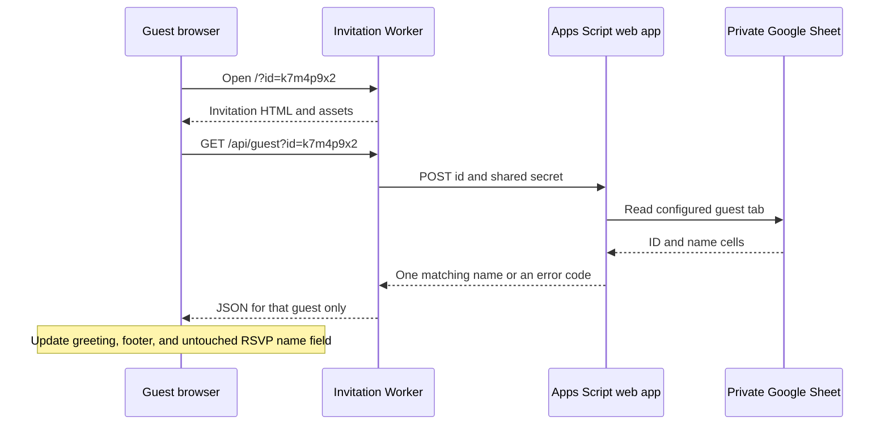

# Guest names from Google Sheets

Status is proposed and awaiting human review. This document contains the architecture and implementation plan only.

Prepared on 6 November 2026. The working target is `vintage-lace-demo`, pending confirmation because this workspace also contains `wedding-invitation`.

## Outcome

A guest opens an invitation URL such as `/?id=k7m4p9x2` and sees the name stored against that ID in Google Sheets. The owner edits the two existing columns in Sheets without rebuilding the invitation. Guests do not sign in to Google.

The proposed zero-cost deployment uses Cloudflare Workers Free, its supplied `workers.dev` hostname, Google Sheets, and Google Apps Script. This assumes usage stays within the providers' free quotas. A purchased custom domain is optional.

The feature can also run on the existing Sites deployment by extending its Worker. The current source proves that Sites is configured, but does not establish its subscription cost. Do not describe Sites pricing as equivalent to a personal Cloudflare Free account.

## Current implementation

The source establishes these integration points.

| Evidence | Current behavior | Design consequence |
| --- | --- | --- |
| `vintage-lace-demo/script.js`, lines 91–96 | Reads a literal name from `khach` or `guest`, updates `[data-guest]`, and fills `#guest-name`. | Add ID lookup at this point and reuse the existing display locations. |
| `vintage-lace-demo/script.js`, lines 111–112 and 146 | Updates the greeting after a successful RSVP. | Keep the resolved invitation name in one variable and preserve the submitted-name behavior. |
| `vintage-lace-demo/worker/index.js`, lines 3–4 and 39–54 | Provides a Worker request router, a JSON helper, `/api/rsvp`, and embedded static assets. | Add one read endpoint to the existing router. |
| `vintage-lace-demo/worker/index.js`, lines 20–32 | Uses the RSVP payload's `id` as a submission UUID for deduplication. | The invitation ID must remain separate from the RSVP submission ID. |
| `vintage-lace-demo/scripts/build.mjs`, lines 6–13 | Embeds images and frontend files into `dist/server/index.js` for Sites. | A standalone Cloudflare deployment needs its own asset packaging and configuration. |
| `vintage-lace-demo/scripts/preview.mjs`, line 18 | Passes only the `DB` binding to the local Worker. | Local integration needs explicit ignored environment settings for the Apps Script connection. |
| `vintage-lace-demo/.openai/hosting.json` | Identifies an existing Sites project with a D1 `DB` binding. | Retain that identity for a Sites update. A different Cloudflare account requires a separate D1 deployment. |
| `wedding-invitation/README.md`, line 18 | The other invitation also uses literal names in URL parameters. | If that is the intended target, revise the file mapping before implementation. |

No Google Sheet contents, production environment values, or production RSVP records were accessed for this proposal.

## Options and decision

| Approach | Cost model | Benefit | Tradeoff | Decision |
| --- | --- | --- | --- | --- |
| Publish the guest tab and fetch CSV or JSON in the browser. | Free public Sheet plus static hosting. | Fewest components. | Visitors can retrieve the complete published list. | Use only if the owner explicitly accepts public guest data. |
| Call an Apps Script web app from the browser. | Apps Script quotas. | No extra API route. | Deployment permissions, redirects, and browser cross-origin behavior need validation. A shared secret in frontend code provides no protection. | Not the default for this existing Worker site. |
| Call Apps Script through the invitation's Worker. | Workers Free plus Apps Script consumer quotas. | Keeps the Sheet private, returns one name, and reuses the existing server. | Adds a Google network dependency and Apps Script deployment setup. | Recommended. |
| Use Sheets API with a service account in the Worker. | Standard Sheets API use is currently available at no additional cost within quota. | Avoids Apps Script and supports a more conventional API integration. | Requires a Cloud project, credentials, token handling, and Sheet sharing with the service account. | A fallback if anonymous Apps Script deployment is unavailable. |

The Laziness Protocol principle favors the existing Worker and plain JavaScript over a framework migration or a second guest database. Boundary Discipline puts request validation and Google response validation at the two network boundaries.

## Request flow

The browser uses a relative API URL on the same origin. The Worker calls Google from the server, so browser CORS is not part of the Google request. Follow Content Service redirects when reading its JSON response. Google's documentation explicitly describes those redirects.

The Apps Script deployment runs as its owner and permits anonymous invocation so the Worker can call it without visitor OAuth. Application code checks a shared secret before reading the Sheet. A Workspace policy may prevent this deployment mode. Verify that account capability before dependent implementation.

## Data and API contracts

The existing two-column layout remains the source of truth.

| Column A, `id` | Column B, `name` |
| --- | --- |
| `k7m4p9x2` | `Anh Nam` |
| `q8v3n6c5` | `Gia đình chị Linh` |

These rows are examples. Configure the spreadsheet ID, tab name, and first data row rather than assuming the owner's current headers. Read displayed cell strings and format the ID column as plain text. Do not coerce IDs to numbers, because `001` and `1` can be different IDs.

Proposed IDs contain 1–128 ASCII letters, digits, underscores, or hyphens. Matching is exact and case-sensitive after trimming surrounding whitespace. Numeric IDs are supported. Confirm the current ID format before applying this constraint. Names are trimmed and contain 1–60 JavaScript string units to fit the existing RSVP validation. Reject an invalid or ambiguous match instead of selecting the first duplicate row.

The public contract is `GET /api/guest?id=<encoded-id>`.

| Condition | HTTP status | JSON |
| --- | --- | --- |
| One valid match. | 200 | `{"name":"Anh Nam"}` |
| Missing, repeated, empty, or malformed ID parameter. | 400 | `{"error":"invalid_id"}` |
| No matching ID. | 404 | `{"error":"guest_not_found"}` |
| Missing server settings, duplicate matched ID, malformed Google response, or upstream failure. | 503 | `{"error":"guest_lookup_unavailable"}` |
| Unsupported method. | 405 | `{"error":"method_not_allowed"}` with an `Allow: GET` header. |

The upstream request is a JSON POST containing `id` and `secret`. Apps Script returns an application envelope with either `ok: true` and `name`, or `ok: false` and a bounded error code. The Worker maps this envelope to the public status codes. Do not rely on Apps Script returning custom HTTP statuses for application errors.

Store `GUEST_LOOKUP_URL` and `GUEST_LOOKUP_SECRET` in the Worker's server environment. Store `SPREADSHEET_ID`, `GUEST_SHEET_NAME`, `GUEST_FIRST_DATA_ROW`, and `GUEST_LOOKUP_SECRET` in Apps Script Script Properties. Local values belong in ignored environment files. No values belong in browser code, `.openai/hosting.json`, committed source, or logs.

The endpoint exposes one name to anyone holding its ID. It does not verify a person's identity. Recommend unpredictable IDs when the owner wants to reduce guessing. Sequential IDs allow enumeration. The shared server secret protects the upstream connection, not the public invitation link. CORS and Origin checks are not visitor authentication.

## Guest experience and update behavior

When there is no `id` parameter, preserve the existing `khach` and `guest` behavior for previously sent links. Without any personalization parameter, show the existing `Quý khách` greeting and make no lookup request.

When `id` is present, treat it as authoritative even if empty or invalid. Ignore literal-name parameters in that case. Keep the generic greeting while the lookup runs. Insert a successful result through `textContent` and update both existing `[data-guest]` elements.

Prefill the RSVP name only if the guest has not edited that field and no submission is in progress or has completed. A late lookup must not replace a guest's typed name or the name shown after a successful RSVP. Keep the lookup failure separate from the RSVP status.

The Worker has a five-second upstream deadline. The browser has a seven-second lookup deadline. These are proposed interaction limits, not measured Google response times. A missing ID match, network failure, or timeout leaves the invitation readable with `Quý khách`. It must not block opening the envelope, viewing photos, or sending an RSVP.

Use `Cache-Control: no-store` for lookup responses and no persistent browser cache. The first version makes one lookup per personalized page load and does not poll Sheets. A saved Sheet edit appears on a subsequent successful lookup without a site deployment. An already open page retains its current name until reloaded. Add a short server cache only if real usage later justifies delayed updates.

## Free deployment

As checked on 6 November 2026, Cloudflare Workers Free includes 100,000 Worker requests per day and 10 ms of CPU time per invocation. Static assets served through its Static Assets facility have free, unlimited requests. These limits do not establish the allowance or price of the existing managed Sites deployment. See [Workers pricing](https://developers.cloudflare.com/workers/platform/pricing/) and [Static Assets billing](https://developers.cloudflare.com/workers/static-assets/billing-and-limitations/).

For deployment in the owner's Cloudflare Free account, serve HTML, CSS, JavaScript, and images with Static Assets and route `/api/*` to the Worker. The current code decodes embedded images in the Worker. Reusing that asset handler unchanged would invoke the Worker for asset requests and consume its daily allowance. Prepare a standalone asset output directory and a Worker entry without the embedded asset map. Keep the Sites build available if the owner retains that deployment.

Use the supplied `workers.dev` address to avoid domain registration cost. Preserve `/api/rsvp` by creating and binding a D1 database as `DB` and applying the existing RSVP migration. D1 has a Free allowance, documented on the same Workers pricing page. The Sites-managed database does not transfer automatically. If the owner needs historical responses on the new host, include a separate reviewed export and import before switching links. Do not silently start a new empty RSVP database as though it contains earlier responses.

Apps Script supports consumer Google accounts with quotas and concurrency limits. This design uses Spreadsheet service reads, not the URL Fetch service. Its URL Fetch daily allowance must not be described as a daily quota for incoming guest lookups. Quota exhaustion can make personalization temporarily unavailable. No traffic guarantee was measured for this project. See [Apps Script quotas](https://developers.google.com/apps-script/guides/services/quotas).

The Sheets API alternative has its own pricing and quotas. Its documentation currently notes planned charging for over-quota use later in 2026, so recheck that alternative before adopting it. See [Sheets API usage limits](https://developers.google.com/workspace/sheets/api/limits).

## Implementation sequence after approval

1. Confirm the intended invitation folder, the Sheet tab and first data row, the existing ID format, and whether to retain the current URL or use Cloudflare Free. Check whether historical RSVPs must move. The Sheet may remain private throughout.
2. Add `vintage-lace-demo/integrations/google-apps-script/Code.gs` with authenticated single-ID lookup. Deploy it as an owner-executed web app. Verify its production `/exec` endpoint works from an anonymous server request and rejects missing or incorrect secrets. This is the first integration gate.
3. Add the `/api/guest` route in `vintage-lace-demo/worker/index.js`. Validate IDs, bound the upstream wait and response size, parse the application envelope, and return the public contract without upstream internals.
4. Update `vintage-lace-demo/script.js` with one resolved invitation name and asynchronous lookup. Preserve legacy links and the existing RSVP submission UUID. Handle the input-edit and submission races described above.
5. Extend local preview to supply ignored server settings. Add meaningful behavior coverage in `scripts/guest.test.mjs`, plus a dependency-injection seam only if needed to simulate the upstream. These are proposed application and test edits, not edits made by this planning task.
6. For standalone Cloudflare hosting, prepare the static asset output and Worker entry, add Wrangler configuration and deployment commands, and bind D1. For the retained Sites variant, keep its project identity and use native runtime environment settings and the source publication workflow instead.
7. Run the existing syntax and RSVP checks, the new guest behavior checks, the selected build, and browser verification. Verify the deployed API against the real Sheet before distributing personalized links.
8. Document Sheet setup, secret configuration, deployment, generic fallback behavior, and link generation in `vintage-lace-demo/README.md`.

Steps 3 and 4 can be prepared independently once the contract and Apps Script capability are established. Integration verification waits for both. Hosting preparation depends on the selected destination. Keep one implementation owner because the existing frontend, Worker, and build files are small and shared. No parallel execution is needed for this feature.

## Acceptance evidence

The implementation is ready only after these checks pass.

- Two different IDs resolve to their own Vietnamese names in both greetings and the untouched RSVP field. The browser response never includes the complete guest list.
- IDs with leading zeros remain distinct. Blank IDs, repeated parameters, malformed IDs, missing names, and duplicate matched IDs fail according to the contract.
- Missing IDs, unknown IDs, a stopped Apps Script deployment, login HTML, invalid JSON, wrong secrets, and timeouts preserve a usable invitation.
- A guest who types or submits before lookup completion keeps that name. The existing RSVP still records a real response and deduplicates retries by its submission UUID.
- A saved name edit in the real Sheet appears on reload without rebuilding the website.
- Old `khach` and `guest` links still work when `id` is absent. An invalid `id` cannot fall through to an arbitrary literal name.
- Desktop and mobile layouts accommodate names up to the existing supported limit. Literal HTML in a name renders as text.
- Production assets work, the API is reachable anonymously, server secrets are absent from public responses and bundles, and the selected host uses the intended free configuration.

This planning task inspected source and official documentation. It did not execute application tests, publish Apps Script, edit application code, access the actual Sheet, or deploy a site. The test and deployment evidence above remains future work.

## Review decision

Approve or revise the proposed Worker-to-Apps-Script architecture, the ID precedence and fallback behavior, and the desired hosting destination before implementation. The recommendation is Cloudflare Workers Free for a separately owned zero-cost deployment, or the existing Worker deployment when retaining the current URL takes priority and its hosting terms are acceptable.

Google deployment details are supported by [Web Apps](https://developers.google.com/apps-script/guides/web) and [Content Service](https://developers.google.com/apps-script/guides/content). This proposal does not depend on a connected visitor Google account.
